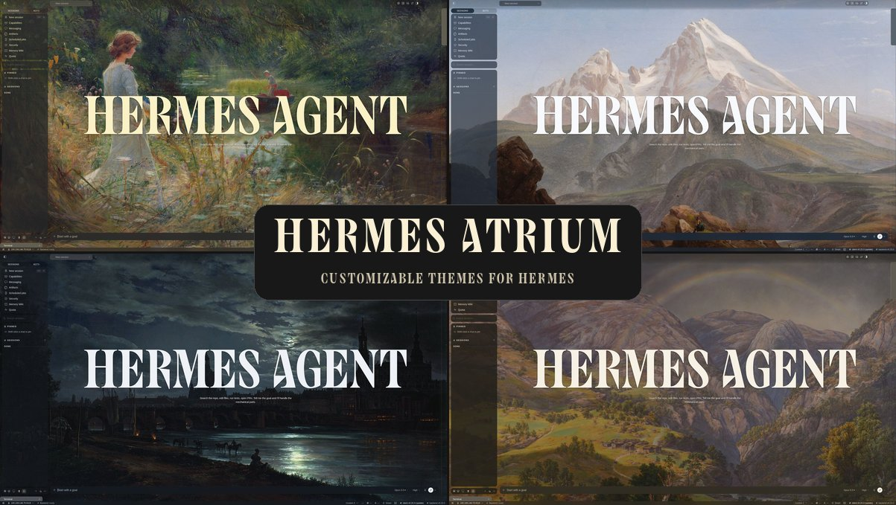
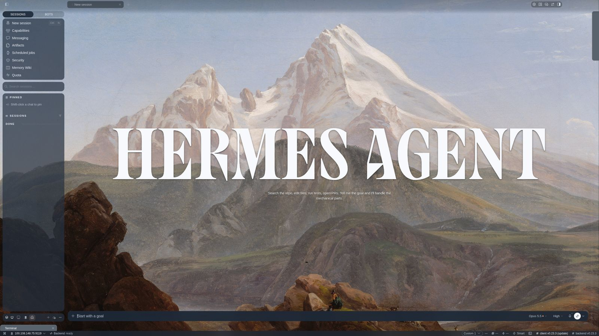
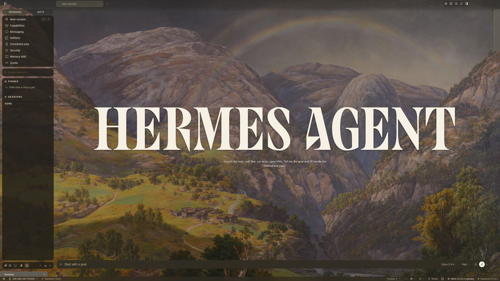
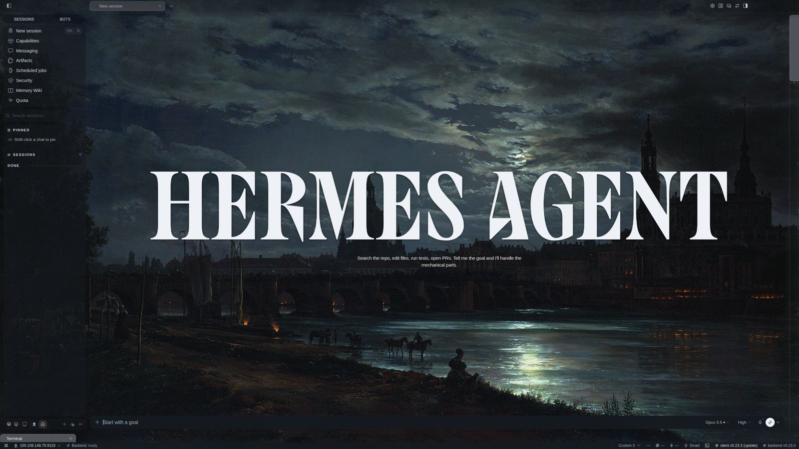
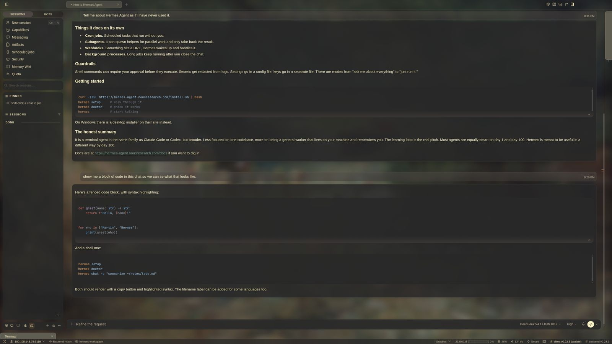
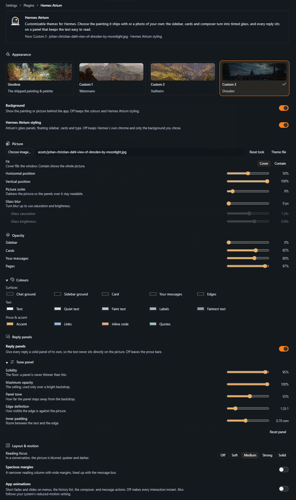
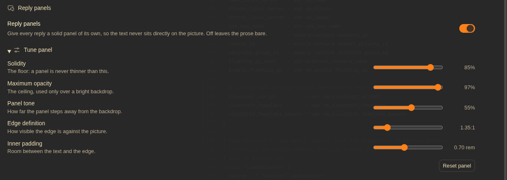

# Hermes Atrium

Customizable themes for Hermes Agent. It puts a painting, or any picture you
choose, behind the app. The sidebar, cards and composer turn into tinted,
translucent glass, and every reply sits on a panel so it stays readable.

<p align="center">
  
</p>

**No network access of any kind.** Nothing leaves your computer. What the
plugin does read and write is listed under
[What it touches on your computer](#what-it-touches-on-your-computer).

## Looks

- **Gruvbox**: *The Backwater* by Charles William Wyllie with Gruvbox colours
  for text and surfaces.
- **Custom 1, 2 and 3**: three slots, each with its own picture, palette and
  opacities, switched from the bottom status bar. They arrive as finished
  looks over public-domain paintings by Johan Christian Dahl, and every value
  can be changed.

| Look | Starts as | Reads as |
| --- | --- | --- |
| Custom 1 | Watzmann | Snow peaks and pale sky behind clear, deep blue glass, alpenglow accent |
| Custom 2 | Stalheim | A storm and a rainbow over sunlit meadows behind olive-brown glass, gold accent |
| Custom 3 | Dresden | The Elbe by moonlight behind near-black glass, lantern amber accent |

| Watzmann | Stalheim | Dresden |
| --- | --- | --- |
|  |  |  |

**Reset look** returns a slot to the look it started as.



## Install

```
hermes plugins install movenstad/hermes-atrium
```

Then enable it in **Settings -> Plugins** (or answer yes when the installer
asks).

## Settings

**Settings --> Plugins --> Hermes Atrium** edits whichever look is selected.
The other looks keep their own values.

| Section | What is in it |
| --- | --- |
| Appearance | The four looks, and the **Background** and **Hermes Atrium styling** switches. |
| Picture | **Choose image…**, the picture's path, **Reset look** and **Theme file**. Then fit, position, the scrim that darkens the picture, and Glass blur. |
| Opacity | How much of the picture the sidebar, cards, your messages and pages let through. |
| Colours | The palette in three groups: surfaces, text, and prose and accent. |
| Reply panels | The panel behind every reply, with five dials under **Tune panel**. |
| Layout & motion | Reading focus, spacious margins and app animations. |



The picture's path box takes a file on your computer (`~/Pictures/x.jpg`) and
applies it on Enter or when you leave the box. Web addresses are refused.

### Reading focus

**Layout & motion --> Reading focus** calms the picture behind a conversation,
for anyone who finds a painting too detailed to read over. It applies to every
look, and only while a chat is open: a fresh draft keeps the picture sharp, and
the first message fades it back.

| Level | What it does in a conversation |
| --- | --- |
| Off | Nothing. |
| Soft | A light blur, slightly less colour, slightly darker. |
| Medium | A stronger blur, quieter colour, darker. The default. |
| Strong | A heavy blur and muted colour, darkest behind the reading column. |
| Solid | Strong, and every reply sits on an opaque panel. |

### Reply panels

**Reply panels** gives every reply a solid panel, so prose never sits directly
on the picture. The panel's tone is solved against the picture actually behind
the reading column, so the same numbers work on a painting and on a photograph
you drop in. With it on, five sliders appear under **Tune panel**:



| Slider | What it does |
| --- | --- |
| Solidity | The floor: a panel is never thinner than this. |
| Maximum opacity | The ceiling, used only when the backdrop is bright enough to need it. |
| Panel tone | How far the panel steps away from the backdrop's own brightness. 0 matches it. |
| Edge definition | How visible the panel's edge must be against the picture, as a contrast ratio. |
| Inner padding | Space between the text and the panel's edge. |

**Reset panel** returns all five to the shipped values.

## Your own pictures

Use **Choose image…** or type a path in the picture box. A path to a file on
disk has no size limit and is the better choice for a large photograph.
Uploaded pictures are kept in the app's local storage, which holds about 5 MB
shared by everything, so an upload is fitted to roughly a third of that.
A picture that will not fit is reported in the console.

## Theme files

Each Custom look has an editable file in your Hermes home folder:

| Look | File |
| --- | --- |
| Custom 1 | `~/.hermes/hermes-atrium-theme.json` |
| Custom 2 | `~/.hermes/hermes-atrium-theme-2.json` |
| Custom 3 | `~/.hermes/hermes-atrium-theme-3.json` |

**Theme file** in Settings opens the one for the selected look, creating it
from the look's current values if needed. Every key is optional; anything left
out keeps its default. Edit it in any editor and the app follows within a couple
of seconds. Moving a knob in Settings writes it back.

## What it touches on your computer

Hermes desktop plugins run inside the app with the app's own access, so this is
the full list of what Atrium does outside drawing the window.

- **Network**: none. No request of any kind, no telemetry, no fonts or images
  from the web. A web address given as a picture, in Settings or in a theme
  file, is refused.
- **Its own folder**: it lists `desktop-plugins/hermes-atrium/assets/` to find
  the shipped pictures. It opens no other plugin's folder.
- **Three theme files outside its folder**: `hermes-atrium-theme.json`,
  `hermes-atrium-theme-2.json` and `hermes-atrium-theme-3.json` in your Hermes
  home folder, one per Custom look. It writes one when you move a knob on that
  look or press **Theme file**, and reads them back so edits made in an editor
  take effect. **Theme file** also asks the system to show the file in your file
  manager.
- **A picture path you choose**: the picture box in Settings or a theme file
  can name a picture anywhere on disk. That file is read by the app's renderer
  to paint it, and nothing else is done with it.
- **Pictures you upload**: kept in the app's local storage, under this plugin's
  own keys, together with your settings and the three looks.
- **The blurred picture Reading focus paints**: made in memory, a few tens of
  kilobytes, and never stored. Only the chosen level is saved.
- **Background work**: one timer, every two seconds, that checks whether a theme
  file changed. It stops when the plugin is disabled.
- **Reading the app's state**: it follows which chat is focused (to tell a fresh
  draft from a conversation) and the active theme. It also adds an empty,
  invisible entry to Hermes's empty-chat slot, which tells it when the focused
  session has no messages yet; it waits a moment (150 ms) before acting on that,
  so a chat that is still loading does not flicker. It does not read messages.
- **No credentials, no shell commands, no processes.**

It reaches these files through the desktop app's own file bridge, because the
plugin SDK's folder access covers neither a plugin's installed folder (where the
pictures ship) nor the Hermes home folder (where the theme files have always
lived).

## Credits

Every picture in `desktop/assets/` is a reproduction of a public-domain
painting (Wyllie died in 1923, Dahl in 1857). None of them is covered by this
repository's own licence.

| File | Used by | Artist | Source |
| --- | --- | --- | --- |
| `johan-christian-dahl-the-watzmann.jpg` | Custom 1, Watzmann | Johan Christian Dahl, *The Watzmann* (1825) | [WikiArt](https://www.wikiart.org/en/johan-christian-dahl/der-watzmann-1825) |
| `johan-christian-dahl-stalheim.jpg` | Custom 2, Stalheim | Johan Christian Dahl, *Stalheim* (1842) | [WikiArt](https://www.wikiart.org/en/johan-christian-dahl/stalheim-1842) |
| `johan-christian-dahl-view-of-dresden-by-moonlight.jpg` | Custom 3, Dresden | Johan Christian Dahl, *View of Dresden by Moonlight* | [WikiArt](https://www.wikiart.org/en/johan-christian-dahl/view-of-dresden-by-moonlight) |
| `charles-william-wyllie-the-backwater.jpg` | Gruvbox, and every fallback | Charles William Wyllie, *The Backwater* | [WikiArt](https://www.wikiart.org/en/charles-william-wyllie/the-backwater) |

### Inspiration

Hermes Atrium got started after trying [Zephyr](https://github.com/Peteryhs/zephyr)
by Peteryhs, a Hermes Desktop plugin with a live sky background.
Parts of its code are used here under its MIT licence, whose notice is included
in [LICENSE](LICENSE).
